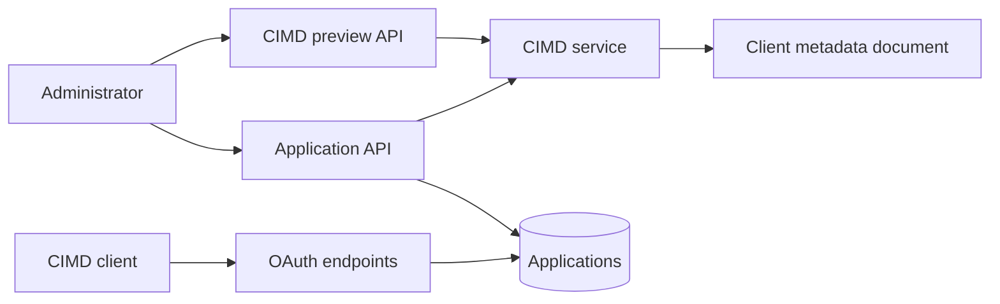
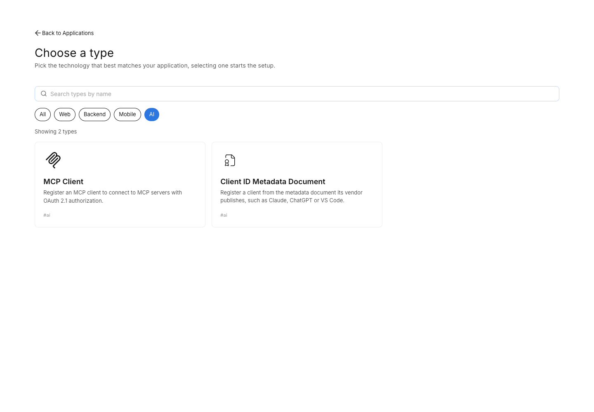
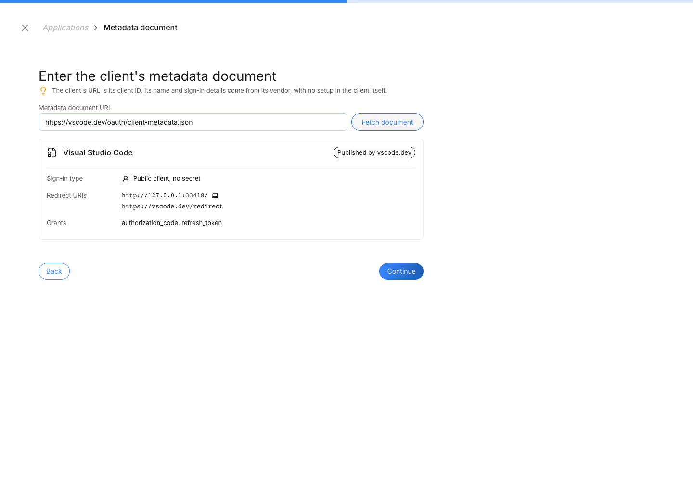
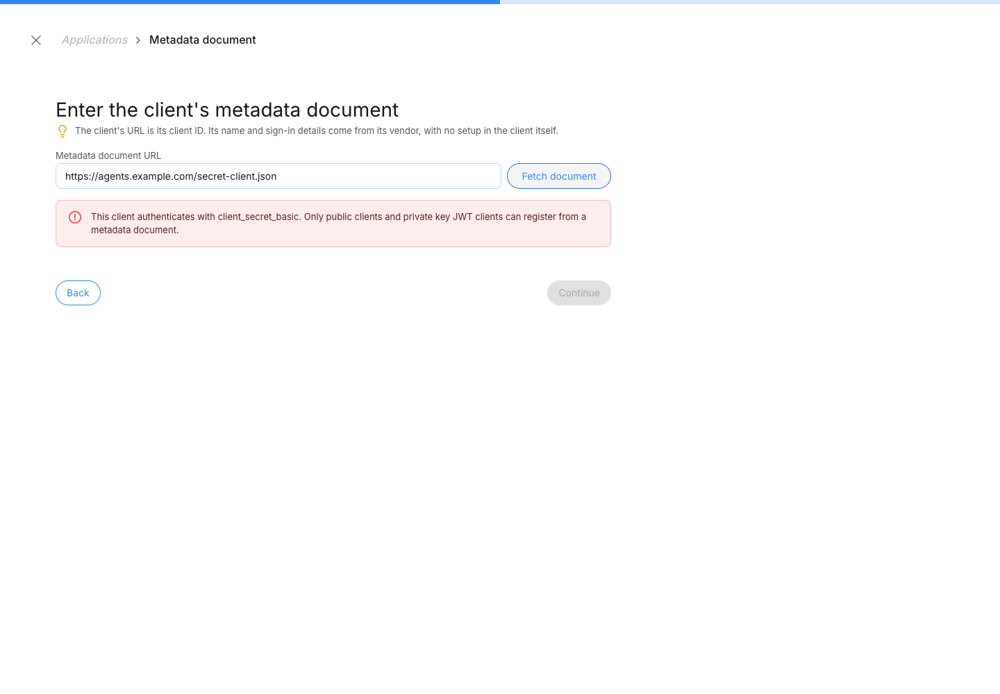
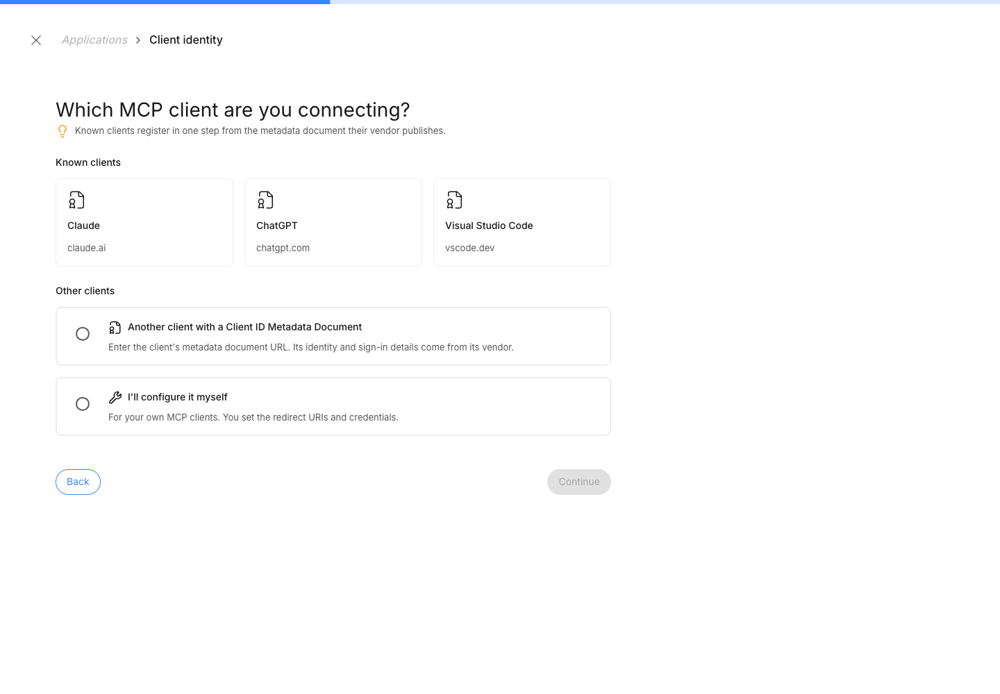
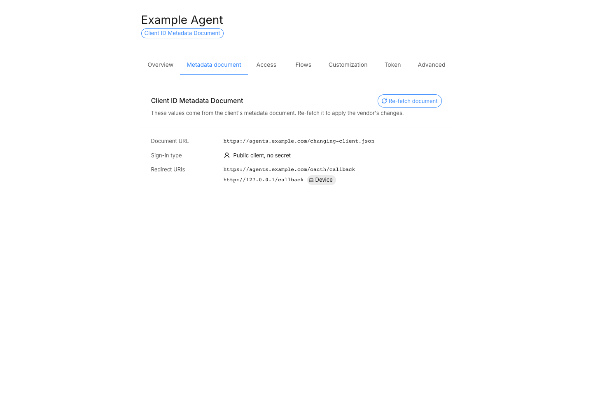
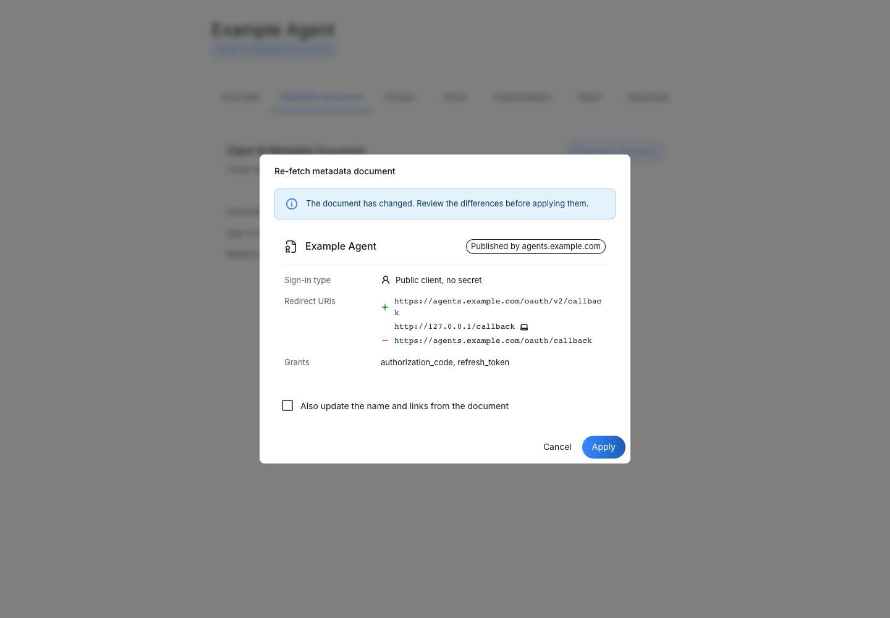

# CIMD Client Registration Specification

- **Status:** Draft
- **Version:** 0.4
- **Related documents:** [MCP authorization specification 2025-11-25](https://modelcontextprotocol.io/specification/2025-11-25/basic/authorization), [MCP authorization security considerations 2026-07-28](https://modelcontextprotocol.io/specification/2026-07-28/basic/authorization/security-considerations), [OAuth Client ID Metadata Document](https://datatracker.ietf.org/doc/draft-ietf-oauth-client-id-metadata-document/)

## Summary

Clients such as Claude, Claude Code, VS Code and ChatGPT identify themselves with a Client ID Metadata Document (CIMD): their `client_id` is an HTTPS URL on the vendor's domain that serves the client's metadata. The MCP authorization specification recommends CIMD over Dynamic Client Registration (DCR), which gives every install an anonymous client and gives administrators no way to allow one app and refuse another.

ThunderID treats CIMD as a way to register an ordinary application. An administrator enters the Client Identifier URL, reviews what the document declares, and confirms. ThunderID stores an application whose `client_id` is that URL, with the redirect URIs, authentication method and key source taken from the document. From then on the client signs in as any other application does. Registration is offered in two places: a CIMD template for any client, and an option inside the MCP Client template. For agents, CIMD registration will come with agent templates, reusing the same preview and document rules.

ThunderID retrieves a document only when an administrator previews one. Creating or updating the application takes the values the administrator reviewed, so what is approved is exactly what is stored. Public clients (`none`) and confidential clients (`private_key_jwt`, handled as DCR handles them) are supported. A confidential client can also use ID-JAG once an administrator adds the grants: it can request identity assertions with the token exchange grant and redeem them with the JWT bearer grant. Redirect URIs match exactly, as for any application. Out of scope are clients that authenticate with a secret, and an enterprise's own clients, which it registers as normal applications. Native clients on an ephemeral loopback port, such as Claude Code, are supported: their loopback redirect URIs match on any port. An application or agent can instead list trusted domains and admit every client on them, with nothing stored per client. See [Domain clients](#domain-clients).

## Architecture



- The **CIMD service** owns preview: it validates the URL, retrieves and validates the document, and returns the values to store. It also holds the document rules, which the Application Service applies to the values submitted when a CIMD application is created or updated. It depends on neither applications nor agents, so agent registration can reuse it.
- Only preview retrieves a document. Create and update never do. The Console never fetches a document itself, because vendors do not send CORS headers for these documents.
- The OAuth endpoints resolve a CIMD client as a registered application by its `client_id`, with no CIMD-specific lookup. A Client Identifier URL that no application holds is an unknown client.

## Detailed design

### Registration

- **Preview** is the only operation that retrieves a document. It validates the document and returns the values in the mapping below: what the administrator reviews, and what create stores. It stores nothing.
- **Create** is the application create operation. It takes the reviewed values with the `clientIdMetadataDocument` marker, applies the document rules to them, and retrieves nothing. What the administrator approved is therefore exactly what is stored, even if the publisher serves a different document afterwards.
- **Known client** registration, offered by the MCP Client template, runs preview and create in one action. Choosing a listed client is the administrator's approval: the Console previews its document and creates the application with the returned values, named from the document, with no further steps. The application page then shows the stored values.
- **Re-fetch** is a preview of the application's URL followed by an application update with the reviewed values. The Console shows what would change before the administrator applies it, and copies the presentation fields only on request.
- There is no single operation that creates an application from a URL alone. API callers preview, then create with the returned values, as the Console does.
- The CIMD marker and `client_id` are fixed at creation. Everything else is edited as for any application, within the document rules.
- Declarative resources carry the stored values, so loading them retrieves nothing.

Create and update check the submitted values, not the live document. ThunderID therefore guarantees that a CIMD application's values satisfy the document rules and were supplied by an administrator, not that they match what the publisher serves at that moment.

The two entry points differ only in the application type they store:

| Entry point | For | Stored type |
| --- | --- | --- |
| CIMD template | Any client that publishes a document | `custom`, as for a DCR registration, since a document can describe any client |
| MCP Client template, a known client or "Another client with a CIMD" | MCP clients | `mcp` |

Each template can list known clients in its template data, as `metadataDocumentClients` entries with a `name` and a `clientId`. The `name` is the client's own name, as its document's `client_name` gives it, not the vendor's product family. Like other template data, the list ships with the Console, and adding a client is a change to the template:

```json
{
  "id": "mcp-client",
  "metadataDocumentClients": [
    {"name": "Claude", "clientId": "https://claude.ai/oauth/mcp-oauth-client-metadata"},
    {"name": "ChatGPT", "clientId": "https://chatgpt.com/oauth/client.json"},
    {"name": "Visual Studio Code", "clientId": "https://vscode.dev/oauth/client-metadata.json"}
  ]
}
```

The MCP Client template lists the known MCP clients above and shows them as tiles. The CIMD template lists none. Choosing a known client does not bypass validation: ThunderID still retrieves and validates its document, and a failure is shown on the step with nothing created. Listing a client does not make ThunderID trust it.

### Mapping from the document

| CIMD field | ThunderID value | Rule |
| --- | --- | --- |
| `client_id` | `oauth2.clientId` | Equals the document URL, stored byte for byte |
| `redirect_uris` | `oauth2.redirectUris` | Copied. See the document rules |
| `token_endpoint_auth_method` | `oauth2.tokenEndpointAuthMethod`, `oauth2.publicClient` | `none` is public, `private_key_jwt` is confidential |
| `jwks_uri` or `jwks` | `oauth2.certificate` (`JWKS_URI` or `JWKS`) | `private_key_jwt` only, stored as DCR stores it |
| `grant_types` | `oauth2.grantTypes` | Narrowed, never widened: the document's `authorization_code` and `refresh_token`, among the grants `oauth.allowed_grant_types` allows. Absent means `authorization_code` |
| `response_types` | `oauth2.responseTypes` | Always `code` |
| `client_name`, `client_uri`, `tos_uri`, `policy_uri`, `contacts` | `name`, `url`, `tosUri`, `policyUri`, `contacts` | Editable defaults. The name falls back to the URL's host |
| `logo_uri`, scopes, token settings, other fields | None | Ignored |

ThunderID also sets `pkceRequired: true` and the `clientIdMetadataDocument` marker. Client secrets are never permitted. Scopes, the login flow, allowed user types and token settings are set by the administrator, as for any application. For a confidential client, the administrator can also add the token exchange and JWT bearer grants to use ID-JAG. Preview never returns them, even when the document declares them, so registering a listed client never grants them. Token exchange serves a CIMD client only for ID-JAG requests: the token endpoint refuses any other exchange with `unauthorized_client`, and a CIMD client holds the grant only while identity assertions (`token.idJag.enabled`) are on.

### Document rules

These rules apply to a document at preview, and to the submitted values when a CIMD application is created or updated. A document, or a set of values, is accepted only when:

- its `client_id` equals the URL it was retrieved from;
- it lists at least one redirect URI, and each is either `https` on the same origin as the Client Identifier URL, or `http` on `localhost`, `127.0.0.1` or `[::1]`. A document that declares `application_type: web` may list no `http` redirect URI, and its `http` post-logout redirect URIs are dropped;
- its `response_types`, when present, include `code`. An absent value means `code`, as in RFC 7591. `code` is the only response type used;
- `token_endpoint_auth_method` is `none`, or is `private_key_jwt` with exactly one of `jwks_uri` or `jwks`. An absent method means `client_secret_basic`, as in RFC 7591, and is rejected;
- it declares no `client_secret`, and an inline `jwks` is a JSON key set of public keys, with no private or symmetric key members such as `d` or `k`;
- its grants include `authorization_code`, and the values stored hold no grant other than `authorization_code` and `refresh_token`, plus `urn:ietf:params:oauth:grant-type:token-exchange` and `urn:ietf:params:oauth:grant-type:jwt-bearer` for a `private_key_jwt` client. These two grants need a client that proves its identity, so a public client cannot hold them. The token exchange grant also needs identity assertions turned on, because it serves a CIMD client only for ID-JAG requests. Because `authorization_code` is required, a client that only redeems ID-JAGs, with the JWT bearer grant and no `authorization_code`, is rejected.

The Client Identifier URL must be an `https` URL with a DNS host and a path, with no user information, fragment or dot segments, and at most 2048 bytes. A `client_id` in an OAuth request must match the registered value byte for byte.

Retrieval uses HTTPS, follows no redirects, applies the fixed time and size limits, and refuses loopback, link-local and private addresses, checked on the address actually connected to. It uses the same protection as ThunderID's other server-side fetches.

The MCP authorization specification says an authorization server SHOULD fetch the document when it sees a URL-formatted `client_id`. For a registered client, ThunderID deliberately fetches only at preview, so authorization does not depend on the vendor's site and document changes take effect only after an administrator reviews them. A [domain client](#domain-clients) has no reviewed values, so its document is retrieved when it signs in.

### Runtime behavior

- **Redirect URIs** match as they do for any application: exactly, or by pattern when the deployment enables `oauth.allow_wildcard_redirect_uri`. One CIMD rule is added, from RFC 8252, section 7.3: a registered `http` loopback redirect URI (`localhost`, `127.0.0.1` or `[::1]`) matches a requested one on any port, when the host, path and query are the same and there is no fragment. A native client that declares a port-less loopback redirect URI and binds an ephemeral port, as Claude Code does, can therefore sign in. Other clients keep exact matching.
- **Confidential clients** authenticate through the existing `private_key_jwt` client authentication, exactly as a DCR client with the same key source. Keys at a JWKS URI are retrieved at the token endpoint, because vendors rotate them, under the same address restriction as document retrieval.
- **Refresh tokens** follow the deployment's refresh token settings, as for any application. The defaults rotate them and revoke the presented one, which is what the MCP authorization specification requires for public clients.
- **Consent** shows the application name, the Client Identifier URL host and the redirect URI host, and warns when the redirect URI host is `localhost`, `127.0.0.1` or `::1`, the loopback hosts the document rules allow, because any local program can claim to be a loopback client. The [MCP authorization security considerations](https://modelcontextprotocol.io/specification/2026-07-28/basic/authorization/security-considerations#localhost-redirect-uri-risks) (2026-07-28) require an authorization server that supports CIMD to clearly display the redirect URI hostname during authorization, and recommend a warning for `localhost` redirect URIs. The authorization request records both hosts, in lowercase ASCII, for a CIMD application in the flow, and the consent step sends them to Gate with the warning flag, so a program that opens the browser cannot change them. An internationalized host is recorded in the ASCII form it resolves as, usually punycode, or in plain punycode when it is not a valid internationalized name, so a host that looks like another one cannot pass for it. When a host has no ASCII form, because it is not valid UTF-8, neither host nor the device warning is shown. They belong to the request, so a client that joins another client's SSO session shows its own hosts, never those of the client that started the session. Other applications show neither host. The hosts appear only on the consent screen: when there is none, because the application's flow has no consent step, the user already consented, or the request has `prompt=none`, nothing is shown, so those authorizations do not yet meet the MCP requirement. Whether to show the hosts on those paths is not decided.

### Domain clients

An application or agent can admit every client whose Client Identifier URL is on a domain it lists, instead of holding one client ID. Its OAuth profile sets `clientIdMetadataDocument: true` and `clientIdDomains` in place of `clientId`:

| Field | Meaning |
| --- | --- |
| `clientIdDomains` | Lowercase DNS names of two or more labels, or `*.` and such a name to match its subdomains. A domain is held by one application or agent only, across the deployment |
| `clientId`, `clientSecret`, `redirectUris`, `postLogoutRedirectUris`, `certificate` | Not set. Each client's document supplies them |
| `tokenEndpointAuthMethod`, `publicClient`, `pkceRequired` | `none`, `true` and `true` on the application or agent. Each client's document decides its own method |
| `grantTypes` | Must include `authorization_code`. A client gets the grants both the application or agent and its document allow, within the [document rules](#document-rules) |
| `token.idJag` | May be enabled, with the token exchange and JWT bearer grants, although the stored method is `none`: identity assertions are issued only to a client whose own document uses `private_key_jwt`, and authenticates with that document's keys. A client whose document uses `none` gets neither grant |

Whether an application or agent holds one client ID or a list of domains is fixed at creation. Everything else is the application's or agent's own configuration: organization unit and sharing, flows, user types, token settings, scopes, consent and design apply to every client it admits. Two settings for the whole deployment are in the `cimd` server configuration section: `enabled`, whether domain clients may sign in at all, and `blockedClientIds`, the Client Identifier URLs refused whatever domain matches. The Console sets the domains when an application or agent is created from the Client ID Metadata Document option, edits them on its page, and edits the two settings on the **Client ID Metadata Documents** tab of **Configurations**.

At sign-in, a `client_id` that no application or agent holds is resolved when `oauth.cimd.enabled` and the section's `enabled` are on, the URL is not blocked, and a listed domain matches its host, the most specific domain winning: the host itself, then the wildcard of each parent, longest first. ThunderID then retrieves the document, applies the [document rules](#document-rules), and builds the client in memory from the admitting application or agent: its client ID, redirect URIs, authentication method and keys come from the document. Nothing is stored for the client.

- **Identity.** The client is addressed by the admitting application's or agent's ID, so flows, sessions and token handling that look a client up by ID see its settings, and tokens carry the client's own `client_id`. Consent is kept per client, under a group derived from that ID and the Client Identifier URL, so consent to one client is never consent to another client of the same application.
- **What users see.** The authorization request sends the login page the Client Identifier URL in place of the application ID, so the sign-in and consent screens show the document's `client_name`, `logo_uri`, `client_uri`, `tos_uri` and `policy_uri`, with the URL's host standing in for a missing name. A flow the login page starts for that URL, such as registration, records the application's or agent's ID.
- **Sign-out.** The document's `post_logout_redirect_uris` that pass the redirect URI rules are accepted after sign-out.
- **Scopes.** When the document declares `scope`, the client may request only those scopes: the authorization and pushed authorization requests, and sign-in through an SSO session, drop any other requested scope. A document that declares none leaves the requested scopes to the application's or agent's own configuration.
- **Keys.** A document that authenticates with `private_key_jwt` and names a `jwks_uri` has its key set retrieved together with the document, with the same protections: HTTPS, no redirects, refusal of loopback, link-local and private addresses on the connected address, a 5 second limit, and at most 64 KB. The set must hold public keys only. The client authenticates with these keys, kept with the document, so the token endpoint never retrieves a URL a document names. A key set that cannot be retrieved makes the client unusable until the document is retrieved again.
- **Documents.** A retrieved document is kept in memory for its response's `max-age`, bounded to between 1 minute and 1 hour, or 5 minutes when the response sets none. Concurrent requests for one URL share a retrieval, and a failed retrieval is remembered for 30 seconds.
- **Withdrawal.** Turning `enabled` off, blocking the URL, removing the domain, or deleting the application or agent stops new sign-ins and refresh token grants for the client. Access tokens already issued stay valid until they expire.

### Data model

- The OAuth configuration in `OAUTH_INBOUND_PROFILE.OAUTH_CONFIG` gains a `clientIdMetadataDocument` flag.
- `CERTIFICATE.REF_ID`, which holds the `client_id` of an OAuth application certificate, is widened from `VARCHAR(36)` to `VARCHAR(2048)` in the PostgreSQL and SQLite config database scripts. Existing PostgreSQL deployments run `ALTER TABLE "CERTIFICATE" ALTER COLUMN REF_ID TYPE VARCHAR(2048);`.

### API

The application API's `oauth2` configuration gains `clientIdMetadataDocument`. When it is `true`, `clientId` must be a Client Identifier URL, the other values are those returned by preview, and they must satisfy the document rules. `clientSecret` must be omitted. Within the document rules, a `private_key_jwt` client may also hold the token exchange and JWT bearer grants, which an administrator adds and preview never returns.

```json
{
  "name": "ChatGPT",
  "type": "mcp",
  "template": "mcp-client",
  "inboundAuthConfig": [
    {
      "type": "oauth2",
      "config": {
        "clientId": "https://chatgpt.com/oauth/client.json",
        "clientIdMetadataDocument": true,
        "redirectUris": ["https://chatgpt.com/connector_platform_oauth_redirect"],
        "tokenEndpointAuthMethod": "private_key_jwt",
        "certificate": {"type": "JWKS_URI", "value": "https://chatgpt.com/oauth/jwks.json"},
        "grantTypes": ["authorization_code", "refresh_token"],
        "responseTypes": ["code"],
        "pkceRequired": true
      }
    }
  ]
}
```

One operation is added, outside the application API so that agent registration can use it later. It requires the system permission, as the application API does:

| Operation | Purpose |
| --- | --- |
| `POST /cimd/preview` with `{ "clientId": "<url>" }` | Retrieve and validate a document, and return the values to store |

The response carries the values in the shape of the fields a create request takes: `name`, `url`, `tosUri`, `policyUri`, `contacts` and `inboundAuthConfig`. The caller copies them into an application create request, and later an agent one.

Errors use `CIMD-` codes, one for each rule, so the Console can say which rule failed. Preview returns `400` for an invalid URL, an unreachable or invalid document, a rule violation, or disabled CIMD. Create and update return `400` with the same codes when the submitted values break a document rule or CIMD is disabled, and `400` when another application already holds the Client Identifier URL, as for any application.

### UI

**Template picker.** A CIMD template sits beside MCP Client.



**Registration from the template.** The first step takes the document URL. ThunderID shows what the document declares, and marks redirect URIs that return to the user's device. The Details step starts from the document's name.



A rejected document shows the rule it broke, next to the URL.



**Registration from MCP Client.** The template's first step asks which MCP client is being connected. Known clients come first, as tiles: choosing one registers it straight away. Below them, "Another client with a CIMD" shows the same URL form and preview as the standalone template, followed by the Details step, and "I'll configure it myself" keeps the existing flow. The Client type step is skipped for both metadata document paths.



**Application details.** The values taken from the document are read-only: a Metadata document tab for the standalone template, and the Connect tab for an MCP client. The Credentials tab and the redirect URI editor are hidden. On the Advanced tab, the authentication method, Public client and PKCE come from the document and cannot be changed. The grant picker offers only the grants the document rules permit: authorization code, which cannot be removed, refresh token, JWT bearer, and token exchange, which follows the identity assertions (ID-JAG) toggle. For a public client, token exchange, JWT bearer and the ID-JAG toggle are disabled with the reason.



**Re-fetch.** Re-fetching previews the application's URL and shows which redirect URIs and grants would be added or removed, and any change to the authentication method. Applying the change updates the values the document owns: the redirect URIs, the authentication method and its keys, PKCE, and the authorization code and refresh token grants it declares. The other grants the application already holds stay while the document rules still permit them for the document's authentication method. When the document no longer declares `private_key_jwt`, token exchange and JWT bearer are removed, and identity assertions are turned off with a warning. Every other setting stays as configured.



**Consent.** For a CIMD application, the consent screen in Gate adds the client and redirect hosts above what the application requests, and the device warning when the redirect URI host is a loopback host:

```text
+--------------------------------------------------------------+
| Visual Studio Code wants to access your account              |
| Published by vscode.dev. Returns to 127.0.0.1.               |
| ! This app runs on your device. Other programs on your       |
|   device can use the same address, so continue only if you   |
|   started this app.                                          |
|                                      [ Deny ]  [ Allow ]     |
+--------------------------------------------------------------+
```

### Configuration

`oauth.cimd.enabled`, deployment-level, defaults to `true`. When it is `false`, preview is rejected, create and update of CIMD applications are rejected, and CIMD applications cannot authorize, refresh, request ID-JAGs with token exchange, or redeem them with the JWT bearer grant. This is not enforced yet: today the flag controls only `client_id_metadata_document_supported` in discovery (#6078).

Retrieval limits are fixed rather than configurable: 5 seconds, 5 KB as the CIMD draft recommends, and the `application/json` media type.

When CIMD is enabled, discovery publishes `client_id_metadata_document_supported: true`.

## Requirements

### R1. Register a CIMD client

**Requirement:** An administrator can register a CIMD client from its Client Identifier URL after reviewing what its document declares, from either entry point.

**Acceptance criteria:**

- **AC1.1:** Given a URL that serves a valid document, when an administrator previews it, then ThunderID returns the values to store and stores nothing.
- **AC1.2:** Given the preview of a valid `none` document, when an administrator creates a client with the returned values from the CIMD template, then ThunderID stores a public `custom` application with those values; and from the MCP Client template, a public `mcp` application.
- **AC1.3:** Given the preview of a valid `private_key_jwt` document with a `jwks_uri`, when an administrator creates a CIMD application with the returned values, then ThunderID stores a confidential application with a JWKS URI certificate.
- **AC1.4:** Given a `none` or `private_key_jwt` document that declares `authorization_code`, `refresh_token`, `urn:ietf:params:oauth:grant-type:token-exchange`, `urn:ietf:params:oauth:grant-type:jwt-bearer` and `urn:ietf:params:oauth:grant-type:device_code`, when an administrator previews it, then the returned grants are `authorization_code` and `refresh_token`. A grant that `oauth.allowed_grant_types` does not allow is never returned, and when it does not allow `authorization_code`, preview rejects the document with the grant rule.
- **AC1.5:** Given a document that breaks a document rule or cannot be retrieved, when an administrator previews it, then ThunderID rejects it with the rule that failed.
- **AC1.6:** Given a create or update of a CIMD application whose submitted values break a document rule, when it is submitted, then ThunderID rejects it with `400` and stores nothing.
- **AC1.7:** Given a publisher that serves a different document after the preview, when the administrator creates or updates the application with the reviewed values, then ThunderID stores the reviewed values and retrieves nothing.
- **AC1.8:** Given a changed document, when an administrator re-fetches and applies the change, then the application takes the redirect URIs, authentication method, key source and grants shown in the preview, keeps the other grants it holds while the document rules still permit them, and keeps every setting the document does not own; and given a document that no longer declares `private_key_jwt`, then token exchange and JWT bearer are removed and identity assertions are turned off.
- **AC1.9:** Given CIMD is disabled, when an administrator previews, or creates or updates a CIMD application, then ThunderID rejects it without retrieving a document.
- **AC1.10:** Given the MCP Client template lists a client in `metadataDocumentClients`, when an administrator chooses it, then ThunderID previews its document and creates the application with the returned values and the document's name, with no further steps; given its document fails validation, then the failure is shown and nothing is created; and given a template that lists none, no known clients are shown.
- **AC1.11:** Given a create or update of a `private_key_jwt` CIMD application, when its grants add the token exchange or JWT bearer grant to `authorization_code`, then ThunderID stores them; and given a `none` CIMD application with either grant, any CIMD application with `client_credentials` or CIBA, or one with the token exchange grant while identity assertions are off, then ThunderID rejects it with `400`.
- **AC1.12:** Given a document or submitted values whose inline `jwks` is not a JSON key set, or holds a private or symmetric key, when it is previewed, created or updated, then ThunderID rejects it with `CIMD-1014`.

### R2. Authorize a registered CIMD client

**Requirement:** A user can authorize a registered CIMD client with no document retrieval at runtime.

**Acceptance criteria:**

- **AC2.1:** Given a registered CIMD application, when its client authorizes with a stored redirect URI, then ThunderID completes the flow without retrieving the document.
- **AC2.2:** Given a Client Identifier URL that no application holds, or one that differs from a registered URL by any byte, when it is submitted as a `client_id`, then ThunderID rejects it as an unknown client.
- **AC2.3:** Given a stored `http://localhost/callback`, when the client requests `http://localhost:3118/callback`, then it is rejected, as for any application.
- **AC2.4:** Given consent is shown for a CIMD application with a loopback redirect URI, then it shows the client host, the redirect host and the device warning; given its redirect URI is `https`, then it shows both hosts without the warning; given its Client Identifier URL host is internationalized, then it shows that host, and an `https` redirect host, in ASCII form; and given consent is shown for any other application, then it shows neither host.

### R3. Authenticate and refresh

**Requirement:** A CIMD client authenticates as its document declared and stays signed in safely.

**Acceptance criteria:**

- **AC3.1:** Given a confidential CIMD application, when a token request carries a valid client assertion signed with a key from its JWKS URI, then ThunderID authenticates it; and without a valid assertion, ThunderID rejects it.
- **AC3.2:** Given a public CIMD application and the default refresh token settings, when a refresh token is used, then ThunderID issues a new one and revokes the presented one.
- **AC3.3:** Given a CIMD application is deleted or CIMD is disabled, when a refresh token is presented, then ThunderID rejects it.
- **AC3.4:** Given a `private_key_jwt` CIMD application with ID-JAG enabled and the token exchange and JWT bearer grants, when it signs a user in, requests an ID-JAG and redeems one, authenticating each token request with a client assertion, then ThunderID issues the ID-JAG with the Client Identifier URL as its `client_id`, and redeems it for an access token; and given the same application requests any other token exchange, then ThunderID refuses it with `unauthorized_client`.

### R4. Restrict retrieval

**Requirement:** Retrieval never reaches an address the deployment did not intend to expose.

**Acceptance criteria:**

- **AC4.1:** Given a document or JWKS URI whose host resolves, on any lookup, to a loopback, link-local or private address, when ThunderID retrieves it, then the connection is refused and the error does not disclose the address.

## Change log

| Version | Date | Change |
|---|---|---|
| 0.1 | 2026-09-28 | Initial specification. |
| 0.2 | 2026-10-22 | Confidential clients can hold the token exchange and JWT bearer grants an administrator adds for ID-JAG, token exchange serves them only for ID-JAG requests, inline key sets must hold only public keys, preview drops grants the deployment does not allow, and the Console offers only the grants the document rules permit and keeps them on re-fetch (#5918). Records that `oauth.cimd.enabled` does not yet stop CIMD clients (#6078). |
| 0.3 | 2026-11-02 | Consent shows a CIMD application's client ID host and redirect URI host in ASCII form, sent by the server through the flow, and warns when the redirect URI host is a loopback host. Nothing is shown when there is no consent screen (#5930). |
| 0.4 | 2026-11-18 | A CIMD client's `http` loopback redirect URI matches on any port, as RFC 8252 requires, so native clients such as Claude Code can sign in. An application or agent can list Client ID domains in place of a client ID and admit every client on them, with nothing stored per client. The `cimd` server configuration section turns this on and blocks client IDs, and the login page shows the client's own name and logo. |
